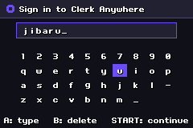
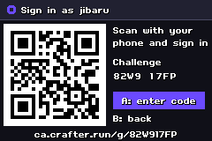
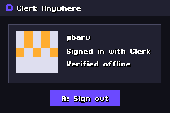

# Clerk on a Game Boy Advance

Sign in with Clerk on a console that has no network. You type your username, scan a
QR code with your phone, sign in with Clerk there, and type the 10-character code it
gives you. The console checks the code with HMAC-SHA256.

| Sign in | Challenge | Profile |
| --- | --- | --- |
|  |  |  |

The flow and its limits are described in [`protocol/offline-code.md`](../../protocol/offline-code.md).

## Build

Requires Docker. The image holds devkitARM and [Butano](https://github.com/GValiente/butano) 21.10.0.

```sh
CA_SECRET="your-secret" \
CA_BASE_URL="HTTPS://YOUR.HOST/G/" \
CA_DISPLAY_URL="your.host/g" \
bash build.sh
```

- `CA_SECRET` must equal `OFFLINE_CODE_SECRET` on the server.
- `CA_BASE_URL` goes into the QR code. Keep it uppercase: uppercase-only text makes a
  smaller QR code, which leaves bigger modules on a 240x160 screen.
- Without these variables the build uses example values.

The result is `clerk-anywhere-gba.gba`. The session is stored in SRAM.

## Test

```sh
CA_SECRET="your-secret" node --experimental-strip-types test/e2e.mjs
```

The test boots the ROM in mGBA, signs in, checks that a wrong code is rejected, signs
in with the right code and signs out. It needs an mGBA build with `--script` support
(0.11 development builds) at `tools/bin/mgba/current/mGBA.exe`, or set `MGBA`.
Screenshots are written to `test/out`.

## Controls

| Button | Action |
| --- | --- |
| D-pad | Move on the keyboard |
| A | Type / confirm |
| B | Delete / back |
| START | Continue |

## Real hardware

Copy the `.gba` file to a flashcart. Use SRAM as the save type. Tested in mGBA; see the
repository README for the hardware status.
